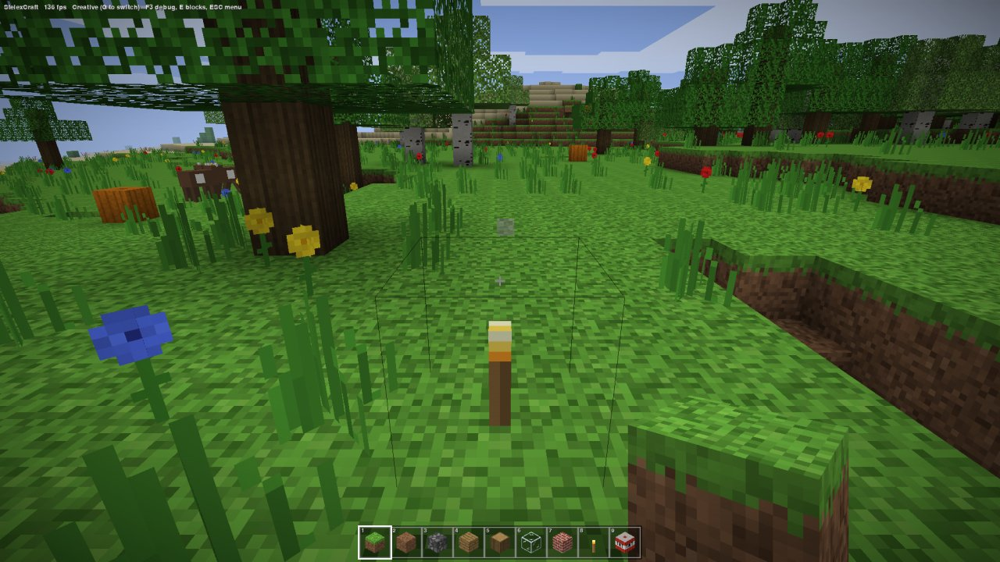
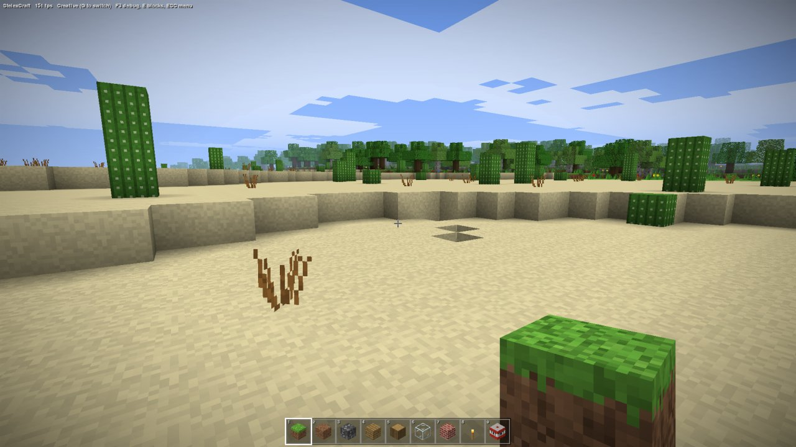
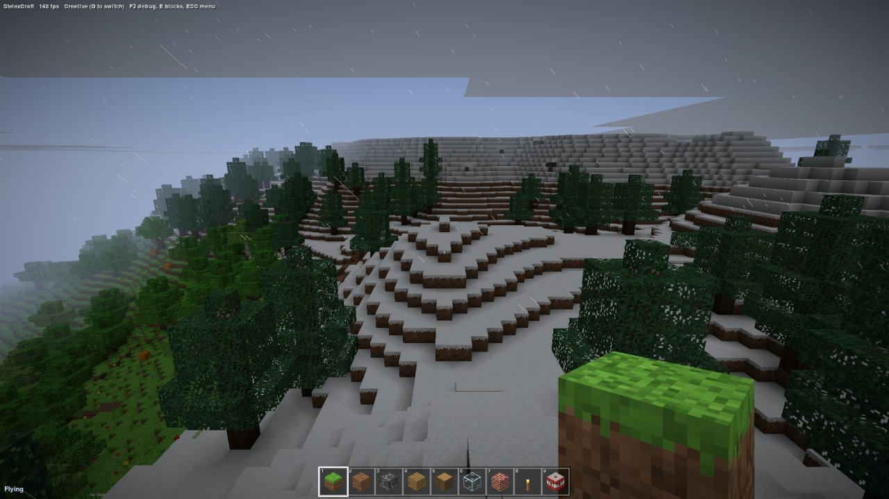
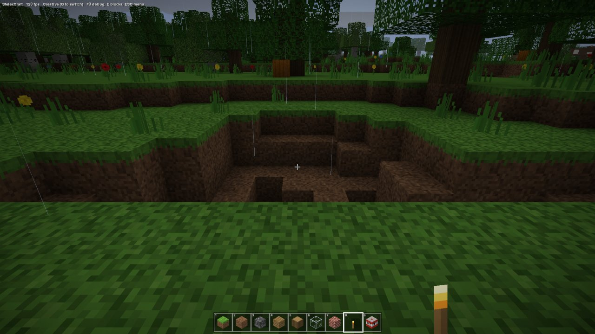
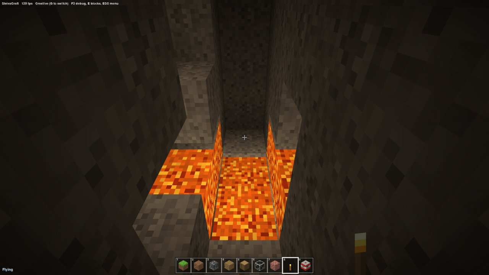
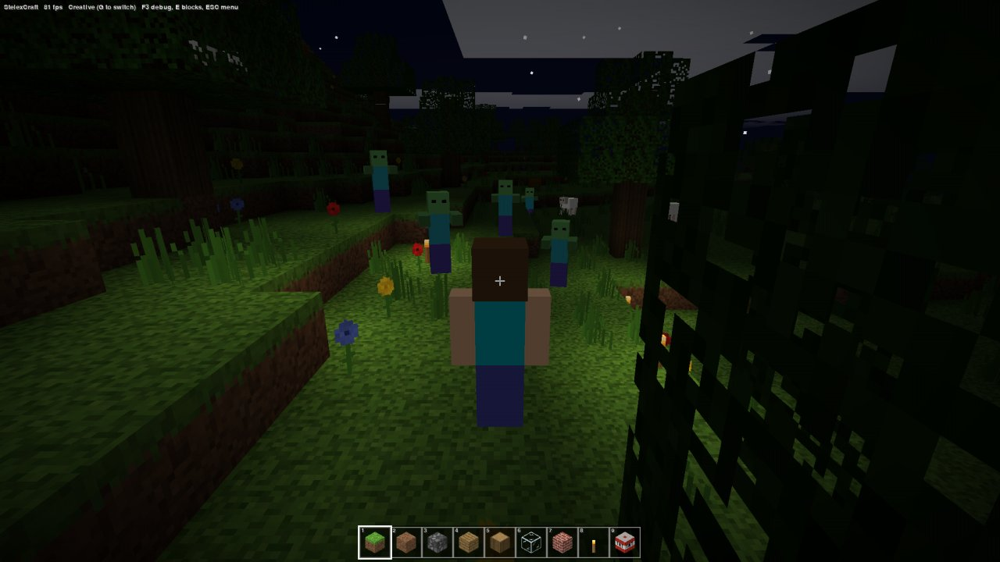
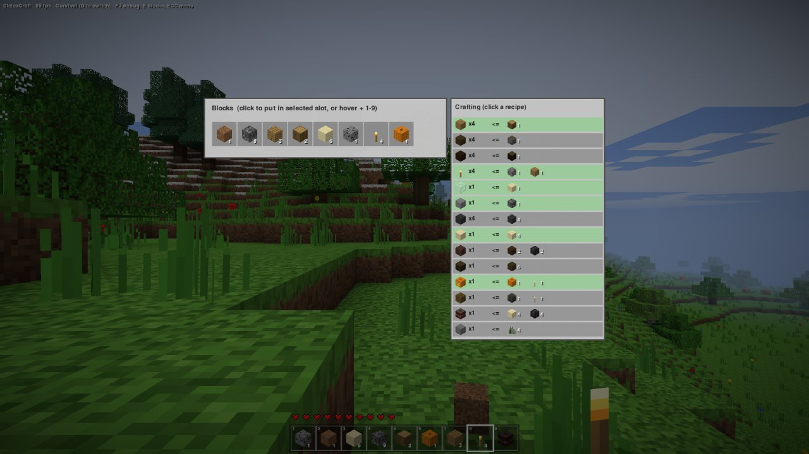
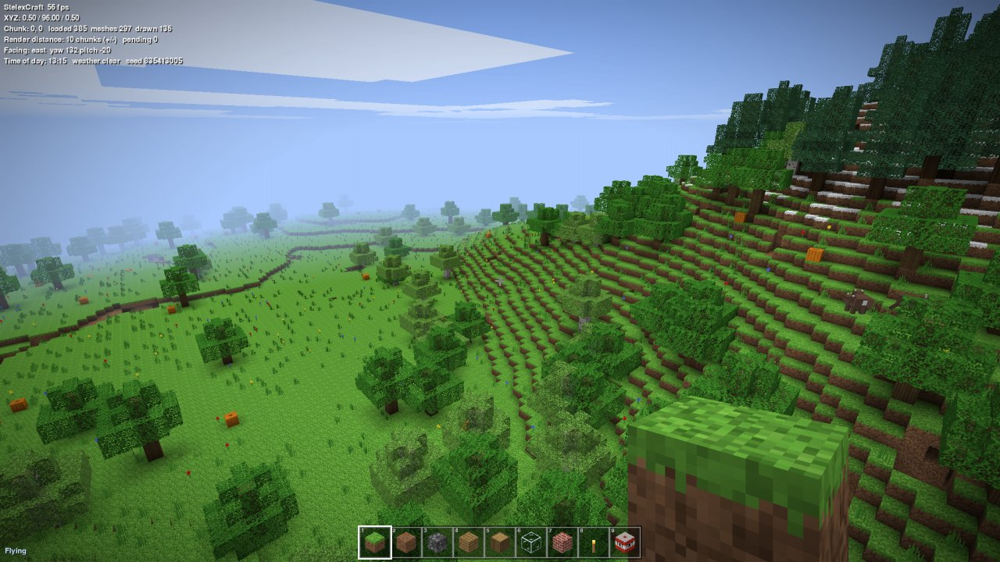

# StelexCraft features

A complete inventory of what StelexCraft has, what it doesn't have, and the issues known so far. Everything here was checked against the source code on 13 October 2026. The screenshots come from automated runs of the game.

See [BUILD_REPORT.md](BUILD_REPORT.md) for how it was built and [COMPARISON.md](COMPARISON.md) for a side-by-side with Minecraft. The controls are listed in the [README](../README.md#controls).

## At a glance

| | |
| --- | --- |
| Game modes | Creative (default) and Survival, switched with G |
| World | Infinite in X and Z, 128 blocks tall, sea level at y=62, random seed per world |
| Block types | 51 (50 in the creative picker; water can't be picked) |
| Mobs | Pigs, sheep, cows, zombies |
| Crafting recipes | 14 |
| Textures | 73 procedurally painted 16×16 tiles (59 block tiles, 10 crack stages, 3 heart states, 1 air bubble) |
| Sounds | 71 synthesized clips |
| Render distance | 10 chunks by default, adjustable from 3 to 16 |
| Frame rate (this machine) | 110–155 FPS in normal play; lowest measured was 56 FPS (see [Performance](#performance)) |
| Save | `world.sav` next to the game, on quit and every 2 minutes |

## Screenshots

| | |
| --- | --- |
|  |  |
| A forest meadow: oak and birch trees, flowers, pumpkins, a cow, and a torch with the block outline | A desert with cacti and dead bushes, with forest beyond |
|  |  |
| Snowfall on a mountain plateau with spruce trees, seen from the summit | Rain, and a crater left by TNT |
|  |  |
| A lava lake in a deep cave, lit only by the lava | Night in third person (F5): zombies, stars, and torches |
|  |  |
| Survival inventory and crafting panel; green recipes can be made now. Hearts sit above the hotbar | A view across the terrain with the F3 debug overlay |

In the night screenshot the zombies were placed by the screenshot script, and they stand still because the player is in creative mode. In the crafting screenshot the inventory was filled by the test script.

## World generation

All generation is in `engine.py` (`gen_chunk`) and is deterministic for a given seed: the same seed always produces the same world. Chunks are 16×128×16 blocks.

### Terrain shape
- The surface height combines four layers of Perlin noise:
  - a broad continental layer, for large lowlands and highlands;
  - rolling hills;
  - a mountain mask;
  - a ridged layer that raises sharp mountain ranges where the mask is high.
- Heights are clamped between y=4 and y=114.
- Terrain is a heightmap, so there are no overhangs or cliffs, apart from where caves break through the surface.

### Surface zones
These come from height and a temperature noise field; there is no full biome system.

| Zone | Rule | Surface |
| --- | --- | --- |
| Ocean and seabed | Surface below sea level | Sand. Deep seabeds (below y=58) get gravel patches. Water fills up to y=62 |
| Beach | Surface at or just above sea level | Sand |
| Desert | Temperature above 0.17 | 5 blocks of sand over 3 of sandstone; cacti and dead bushes; no trees; no rain |
| Grassland and forest | Everything else | Grass over 3–4 blocks of dirt; trees where a forest-density noise is high |
| Snowy highland | Above roughly y=88–92 | Snowy grass; spruce trees; snowfall instead of rain |
| Peaks | Above y=104 | Snow blocks over stone; no trees |
| Cold areas | Temperature below −0.25 | Spruce instead of oak and birch |

### Underground
- **Tunnels.** Long winding caves form where two 3D noise fields are both near zero.
- **Caverns.** Large open caves form below y=48, where a third noise field is high.
- **Cave openings.** On land, caves can reach the surface and leave entrances and small pits. Near and under the sea they stop 6 blocks below the seabed, so oceans don't drain into them.
- **Lava.** Any cave air from y=2 to y=10 becomes lava, which creates lava lakes in deep caves.
- **Bedrock.** Fills y=0, half of y=1 and a fifth of y=2, so the floor is uneven.
- **Ores** are placed as random-walk veins that replace only stone:

| Ore | Veins per chunk | Height range | Max vein size |
| --- | --- | --- | --- |
| Coal | 20 | y 5–110 | 9 |
| Iron | 12 | y 5–64 | 7 |
| Gold | 3 | y 5–32 | 6 |
| Diamond | 2 | y 3–16 | 5 |
| Gravel pockets | 6 | y 5–100 | 18 |
| Dirt pockets | 6 | y 5–100 | 18 |

### Trees and plants
- **Oak trees.** Trunks 4–6 blocks tall with a rounded crown. Corner leaves are randomly trimmed, so no two crowns are identical.
- **Birch trees.** One in four broadleaf trees: the same shape with white bark and lighter leaves.
- **Spruce trees.** Trunks 6–9 blocks tall with a layered, conical crown, growing in snowy or cold areas.
- Trees near a chunk border are generated correctly: each chunk also considers trees rooted up to 3 blocks into its neighbors.
- **On grass:**
  - tall grass on about 12% of grass blocks;
  - dandelions, poppies and cornflowers on about 0.7% each;
  - pumpkins on about 0.15%.
- **Sugar cane** grows 1–3 blocks tall on grass or sand next to water.
- **Cacti** grow 1–3 blocks tall, and **dead bushes** appear on desert sand.

## Blocks

51 block types:

| Group | Blocks |
| --- | --- |
| Terrain | Grass Block, Dirt, Stone, Sand, Gravel, Sandstone, Snowy Grass, Snow Block, Bedrock, Water, Lava |
| Ores | Coal Ore, Iron Ore, Gold Ore, Diamond Ore |
| Trees | Oak Log, Oak Leaves, Birch Log, Birch Leaves, Spruce Log, Spruce Leaves |
| Plants | Tall Grass, Dandelion, Poppy, Cornflower, Dead Bush, Sugar Cane, Cactus, Pumpkin |
| Building | Cobblestone, Mossy Cobblestone, Oak Planks, Spruce Planks, Glass, Bricks, Stone Bricks, Bookshelf, Obsidian |
| Wool | White, Red, Orange, Yellow, Lime, Cyan, Blue, Purple, Black |
| Light and special | Torch (light 14), Glowstone (light 15), Jack o'Lantern (light 15), TNT |

Lava also gives off light 15.

### Block behavior
- **Falling blocks.** Sand and gravel fall when the block below them is removed or when you place them over a gap. Whole columns fall together.
- **Plant support.**
  - Flowers, grass, dead bushes and sugar cane can only be placed on grass, dirt, snowy grass or sand.
  - Plants and torches on top of a broken block are removed with it.
- **Stalks.** Breaking any piece of a sugar cane or cactus stalk breaks everything above it. In survival, each piece drops.
- **Replacing.** Tall grass, water and lava are replaced when you place a block into them. Clicking tall grass places into its space.
- **Water.** Breaking a block next to water fills the hole with water. This stands in for flowing water, which the game doesn't have.
- **TNT.** Right-click TNT to light it. It flashes for 3 seconds, then explodes in a rough sphere of radius 4:
  - Water, bedrock and obsidian survive.
  - Other TNT in the blast lights with a short random fuse, so chain reactions happen.
  - The explosion shakes the camera, pushes the player and mobs away, kills animals and zombies within 5 blocks, and in survival damages the player (up to 20 points, a full health bar, at point-blank range).
- **Transparency.**
  - Glass and leaves are see-through.
  - Leaves, plants and torches use cut-out pixels.
  - Water is semi-transparent.
  - Leaves dim light slightly more than air.

## Graphics

### Rendering pipeline
- **OpenGL 3.3 core** through moderngl. There are three shader programs: terrain, simple (entities, particles, sky, outlines) and interface.
- **One mesh per chunk.**
  - Only faces next to a non-opaque block are emitted.
  - Faces between two blocks of the same type (glass to glass, leaves to leaves) are skipped.
  - Each vertex is 16 bytes: half-float position and texture coordinates, plus four bytes for sky light, block light, and shading with ambient occlusion.
  - All chunks share one quad index buffer.
- **Camera-relative drawing.** Chunk positions are passed as offsets from the camera, so precision holds far from the origin.
- **Frustum culling** is done per chunk column.
- **Water** is drawn in a second pass, chunk by chunk from far to near, at 72% opacity.
- **Background workers.** Generation, lighting and meshing run on a pool of worker threads (2 to 8, depending on the CPU). Finished meshes are uploaded within a 6 ms per-frame budget, nearest chunks first. When you edit a block, that chunk and any touching chunk border remesh immediately, so edits never lag.
- **Texture atlas.** 256×256 with mipmaps and nearest-neighbor filtering, so pixels stay sharp up close and don't shimmer far away.

### Lighting
- **Two light channels per block, levels 0–15**, as in Minecraft:
  - **Sky light** pours straight down through open air, then spreads sideways, losing one level per block.
  - **Block light** spreads from torches, glowstone, jack o'lanterns and lava.
- **Smooth lighting and ambient occlusion.** Each vertex averages the light of the blocks around it, and corners and creases get darker. Quads are split along the diagonal that avoids lighting seams.
- **Face shading.** Top faces are full brightness, north and south 80%, east and west 62%, and bottoms 50%, close to Minecraft's own values.
- **Day and night.** Sky light is scaled by a daylight value, so the whole world darkens at night without recomputing light. Torch-lit areas get a warm tint.
- **Entity lighting.** Mobs, item drops and the held item are lit by a cheap sky-exposure check: full brightness under open sky, darker under cover, and brighter again near a light source.

### Sky, weather and atmosphere
- **Day length.** A full day takes 20 minutes. A new world starts just after sunrise.
- **Sky.** A dome fades from a deeper blue overhead to a paler horizon, and turns orange at sunrise and sunset.
- **Fog** matches the horizon color, so distant terrain fades into the sky.
- **Sun, moon and stars.** The square sun and moon cross the sky. 700 stars rotate with the sky and fade in at dusk.
- **Clouds.** A flat layer at y=118 drifts slowly and darkens at night and in rain.
- **Rain showers** start and stop on their own: rain lasts 1–2.7 minutes and clear spells 3–7 minutes. F7 toggles rain.
  - Rain streaks fall in a 40×40-block area around the player and stop at the highest block in their column, so it doesn't rain under roofs or trees.
  - Rain darkens the sky and the world, fades out the sun and moon, and has its own looping sound.
  - Above about y=88 it snows instead: slow, drifting flakes.
  - Deserts get no rain.
- **Underwater.** Close blue fog and a blue tint.
- **Edge vignette.** A slight darkening at the screen edges.

### Animation and effects
- Grass, flowers and other plants sway; water surfaces ripple; lava pulses and glows.
- **Breaking blocks** throws out small particles textured with that block.
- **Torches** give off small wisps of smoke.
- **Mobs** disappear in a puff of smoke when killed or when burned by sunrise.
- **Block outline.** A thin dark wireframe outlines the targeted block.
- **Mining cracks.** In survival, a 10-stage crack overlay grows while you mine.
- **Held item.**
  - The selected block appears in 3D at the bottom right; plants and torches appear as flat sprites.
  - It swings when you click and bobs as you walk.
  - In survival, an empty slot shows a bare arm instead.
- **Camera.**
  - The view bobs while walking, and the field of view widens from 70° to 80° while sprinting.
  - Explosions shake the camera.
  - Taking damage tilts it briefly and flashes the screen red.
- **Third person (F5).** The camera sits behind a Steve-like player model whose arms and legs swing as it walks. The camera moves in closer when a wall is in the way.

## Player and movement

| Action | How | Details |
| --- | --- | --- |
| Walk | WASD | 4.32 blocks/s |
| Sprint | Ctrl, R, or double-tap W | 5.61 blocks/s; wider field of view; extra push when jumping |
| Sneak | Shift | 1.3 blocks/s; the camera lowers; you can't walk off edges |
| Jump | Space | About 1.27 blocks high |
| Fly (creative only) | Double-tap Space | 10.9 blocks/s, 21.6 when sprinting; Space and Shift rise and descend; landing ends flight |
| Swim | Space in water | Slower movement; hold Space to rise; lava behaves like water for movement |
| Reach | | 5 blocks for blocks, 4 for mobs |

- **Collision.** The player is 0.6×1.8 blocks with eyes at 1.62.
- **Gravity.** 32 blocks/s², with a top falling speed of 60 blocks/s.
- **Footsteps.** Step and landing sounds match the block underfoot.
- **The void.** Falling below y=−30 returns you to the sky in creative and kills you in survival.

## Creative mode
- **Building.** Blocks break instantly, and both breaking and placing repeat every 0.25 s while the button is held.
- **Block picker (E).** A grid of all 50 placeable blocks. Click one to put it in the selected hotbar slot, or hover over one and press 1–9 to put it in that slot.
- **Pick block.** Middle-click a block in the world to select it, or put it in the current hotbar slot.
- **Infinite supply.** No block is ever used up.
- **Zombies ignore you.**

## Survival mode
Press G at any time to switch. Switching restores full health and turns off flying.

### Mining
Holding the left button mines over time and shows the crack overlay. There are no tools; mining times are roughly those of Minecraft with a basic tool:

| Time | Blocks |
| --- | --- |
| Near-instant (0.05 s) | Plants, torches, TNT |
| 0.25 s | Leaves |
| 0.4 s | Glass, glowstone |
| 0.6 s | Grass, dirt, sand, gravel |
| 0.8 s | Wool, snow, cactus |
| 1.3 s | Logs, planks, bookshelves, pumpkins, jack o'lanterns |
| 1.6 s | Stone, cobblestone, bricks, stone bricks, sandstone, mossy cobblestone |
| 2.2–2.8 s | Coal, iron, gold and diamond ore |
| 6 s | Obsidian |
| Never | Bedrock |

### Drops and inventory
- **What drops.**
  - Grass and snowy grass drop dirt, and stone drops cobblestone.
  - Leaves and glass drop nothing.
  - Everything else drops itself, ores included; there are no coal, iron or diamond items.
- **Item drops.**
  - Drops pop out as small spinning blocks.
  - After 0.4 s they are pulled toward you from up to 2.5 blocks away and collected within 1 block, with a pickup sound.
  - Uncollected drops disappear after 5 minutes.
- **Inventory.**
  - The inventory is a count per block type, with no slot or stack limits.
  - New blocks go into an empty hotbar slot automatically. Hotbar slots show counts, and slots you've run out of are dimmed.
  - Placing a block uses one; you can only place blocks you have.
- **Not obtainable in survival:** grass blocks, snowy grass, leaves, bedrock, water, lava, obsidian, mossy cobblestone and the eight colored wools. That is 18 of the 51 block types.

### Crafting
Press E to open the inventory with a crafting panel beside it. Recipes you can make now are green; click one to craft it. Hovering shows the recipe in words.

| Makes | From | Same as Minecraft? |
| --- | --- | --- |
| 4 Oak Planks | 1 Oak Log | Yes |
| 4 Oak Planks | 1 Birch Log | Close (Minecraft gives birch planks) |
| 4 Spruce Planks | 1 Spruce Log | Yes |
| 4 Torches | 1 Coal Ore + 1 Oak Planks | Close (Minecraft: coal + stick) |
| 1 Glass | 1 Sand | Stand-in for smelting sand |
| 1 Stone | 1 Cobblestone | Stand-in for smelting cobblestone |
| 4 Stone Bricks | 4 Stone | Yes |
| 1 Sandstone | 4 Sand | Yes |
| 1 Bricks | 2 Dirt + 2 Gravel | Invented (Minecraft: 4 bricks smelted from clay) |
| 1 Bookshelf | 6 Oak Planks | Simplified (Minecraft also needs 3 books) |
| 1 Jack o'Lantern | 1 Pumpkin + 1 Torch | Yes (Minecraft carves the pumpkin first) |
| 1 Glowstone | 1 Gold Ore + 1 Torch | Invented (Minecraft: glowstone dust from the Nether) |
| 1 TNT | 4 Sand + 4 Gravel | Invented (Minecraft: 5 gunpowder + 4 sand) |
| 1 White Wool | 4 Tall Grass | Invented (Minecraft: 4 string, or shearing sheep) |

### Health and damage
Health is 20 points, shown as 10 hearts with halves. The hearts shake when health is low.

| Source | Damage |
| --- | --- |
| Falling | 1 per block beyond 3, for falls of more than 3.5 blocks; landing in water is safe |
| Drowning | 10 seconds of air (bubbles show above the hotbar), then 2 per second |
| Lava | 4 every half second |
| Cactus | 1 every half second while touching one |
| Zombie | 3 per hit, at most one hit per second, with knockback |
| TNT | Up to 20 within 8 blocks, scaled by distance |
| The void | Fatal |

- **Regeneration.** Below full health you regain 1 point every 3 seconds. There is no hunger.
- **Death.** Shows "You died!" and a Respawn button. Your inventory is cleared, not dropped. You respawn at the world spawn point.

## Mobs

| Mob | Where and when | Behavior | Hits to kill |
| --- | --- | --- | --- |
| Pig, sheep, cow | On grass, 18–56 blocks from you, in groups of 1–3 | Wander, stop, turn; jump up single blocks; float in water; make sounds now and then; run when hit | 4 |
| Zombie (night) | At night, on any opaque surface 16–40 blocks away, up to 8 at a time | In survival: chase you within 24 blocks, hit for 3 with knockback, groan. In creative: wander | 6 |
| Zombie (caves) | When you are under cover with no light source nearby, up to 6, in dark spots 8–16 blocks away | Same | 6 |

- **Limits.**
  - Animals stop spawning once 14 mobs of any kind exist.
  - Zombies have their own caps: 8 for night spawns and 6 for cave spawns.
  - Mobs more than 110 blocks away are removed.
- **Sunrise.** Zombies under open sky vanish in smoke shortly after sunrise. Zombies under cover survive.
- **Models.** Mobs are box models in Minecraft proportions:
  - Animals have four walking legs; pigs have a snout; cows have patches and horns.
  - Zombies have the familiar green skin, teal shirt, blue trousers and outstretched arms.
  - Mobs flash red when hit.
- **Drops.** Mobs drop nothing.

## Sound
All 71 sound clips are synthesized at startup from noise and tones:
- **Block sounds.** Break, place and footstep sounds for six materials: stone, grass, wood, sand, glass and wool.
- **Explosions.** A TNT fuse hiss and an explosion.
- **Player.** Hurt, item pickup, and a splash when you fall into water.
- **Mobs.** Pig, cow and sheep voices; zombie groans; a pop when a mob dies.
- **Weather.** A rain loop that fades with the rain's intensity.

Animal and zombie sounds get quieter with distance but have no left/right placement. There is no music.

## Interface
- **Hotbar.** 9 slots with 3D block icons, slot numbers, a highlighted selection, stack counts in survival, and the block's name shown briefly when you change slot.
- **Crosshair.** Drawn in inverted colors so it shows against any background.
- **Status line.** The top-left corner always shows "StelexCraft", the frame rate, the game mode and key hints. F1 hides it and F3 replaces it.
- **Debug screen (F3):**
  - frame rate and position (XYZ);
  - chunk, with counts of loaded, meshed and drawn chunks;
  - render distance and pending work;
  - facing, yaw and pitch;
  - time of day, weather and world seed;
  - the targeted block.
- **Pause menu (Esc):**
  - Back to Game, Save and Quit, and New World (which replaces the current world);
  - a summary of the controls;
  - Q also quits from this menu.
- **Auto-pause.** The game pauses when its window loses focus.
- **Other screens.** A "Generating terrain..." screen while the first chunks load, the death screen, and brief messages (for example, when switching modes).
- **Other keys:**
  - F2 saves a screenshot to `screenshots/`, named by date and time.
  - F11 toggles fullscreen.
  - `+` and `-` change render distance.
  - `[` and `]` change mouse sensitivity.
- **Scaling.** The interface scales with the window height. Text uses pygame's default font.

## Saving
- **What is saved.** `world.sav` holds:
  - the seed and the edits you made to each chunk (generated terrain is rebuilt from the seed, so saves stay small);
  - your position and view direction, and whether you are flying;
  - the time of day and game mode;
  - the hotbar, inventory and health;
  - the spawn point.
- **When.** On quit and every 2 minutes. Each save is written to a temporary file and then renamed into place, so a crash during saving can't corrupt the existing save.
- **New World** in the pause menu starts a fresh random world. The old world is lost at the next save.
- **To start over,** delete `world.sav`.

## Performance
Measured on the build machine: NVIDIA Quadro RTX 3000 Max-Q laptop GPU, Windows 10, 2048×1152 window.

| Measurement | Result |
| --- | --- |
| Chunk generation | About 1.3 ms per chunk on one thread |
| Chunk lighting and meshing | About 6.7 ms per chunk on one thread |
| First launch | About 15 s extra while numba compiles the engine; later launches reuse the compiled code |
| Normal play, 10-chunk render distance | 110–155 FPS |
| Busiest test scene (night, rain, several zombies, third person) | 70–90 FPS |
| Lowest measured: flying 20 blocks up, looking across the landscape, F3 open | 56 FPS |
| CPU time per frame | About 7 ms of Python, spread over terrain draw calls, mobs and the interface |

- **Tearing.** Vsync is off because this machine's primary monitor runs at 30 Hz, which would cap the game at 30 FPS. Frame rate is capped at 144 instead, so some screen tearing is possible.

## What it doesn't have

### Survival depth
- **Missing systems:** hunger, food, experience, armor, tools, weapons, durability.
- **Missing crafting stations and storage:** furnaces and smelting, crafting tables and the crafting grid, enchanting, brewing, chests.
- **Missing respawn and rules options:** beds and custom respawn points, difficulty settings, hardcore mode, adventure and spectator modes.
- **No items other than blocks.** There are no sticks, coal, ingots, food, buckets, flint and steel, bows or anything else that isn't a placeable block. You can't throw items away.

### World
- **No real biome system:** six height and temperature zones instead of named biomes, and grass and leaf colors that don't change by region.
- **Terrain shape:** no rivers, ravines, cliffs or overhangs, and mountains are smooth terraces.
- **Missing terrain features:** no clay, ice, snow layers or underwater plants.
- **No structures:** no villages, dungeons, mineshafts, strongholds, temples or ruins.
- **One dimension only:** no Nether, no End, no portals.
- **Smaller world, fixed settings:** 128 blocks tall, with no choice of seed or world type.

### Block behavior
- **Fluids:** water and lava don't flow.
- **Fire and redstone:** no fire, no redstone.
- **Missing shaped blocks:** doors, trapdoors, fences, slabs, stairs, ladders, signs.
- **Nothing grows:** no farming, crops or saplings; trees don't grow; grass doesn't spread; leaves don't decay.
- **No orientation:** logs always stand upright, and torches can't be mounted on walls.

### Mobs
- **Only four mob types:** no creepers, skeletons, spiders, endermen, villagers or any other mob.
- **No interaction beyond hitting:** mobs drop nothing; no breeding, taming or riding.
- **Simple movement:** mobs walk straight and jump obstacles; there is no pathfinding.

### Interface and audio
- **Missing screens:** no title screen, world list, settings screen, key rebinding or GUI scale option.
- **Missing features:** no chat or commands, no recipe book beyond the crafting panel, and no Minecraft font.
- **Audio:** no music, no ambient sounds, no stereo placement of sounds.

### Platform
- **No multiplayer.**
- **No extensibility:** no mods, resource packs or data packs.
- **No accounts:** no skins or achievements.
- **No controller support.**

## Known issues and quirks
Most of these were found by reading the code while writing this document. None crashes the game, and none blocks play.

1. **Plants and torches vanish without dropping in survival** when you break the block under them. Sugar cane and cactus pieces do drop.
2. **Torches always stand upright and need no support.** Clicking the side of a wall places an upright torch in the space beside it, even in mid-air.
3. **Torches don't stop zombies spawning on the surface at night.** Cave spawning does avoid lit areas.
4. **Sand and gravel drop instantly** to their resting place instead of visibly falling.
5. **Only creative mode can pick block.** Middle-click does nothing in survival.
6. **F5 has two views,** first person and behind the player, with no front view.
7. **G switches modes at any time and refills health,** so survival has no cheat protection.
8. **Settings aren't saved.** Render distance and mouse sensitivity reset every launch.
9. **Plenty of things aren't saved:** mobs, item drops, lit TNT and the weather. Animals respawn fresh after loading.
10. **Clouds sit just above the peaks.** They are at y=118 and the highest peaks reach y=114, so on mountaintops a flat gray cloud layer hangs just overhead (visible in the snowy screenshot).
11. **The cave pattern repeats every 6,400 blocks** along X and Z, because of how the noise is tiled. Surface terrain repeats only on scales of 23,000 blocks and more.
12. **Spruce logs show oak log ends** on their top and bottom faces.
13. **Explosions destroy blocks without dropping anything.**
14. **Weather changes much more often than in Minecraft.**
15. **The save is a Python pickle.** Loading one can run arbitrary code, so only load `world.sav` files you made yourself.
16. **Some screen tearing is possible** because vsync is off (see [Performance](#performance)).
